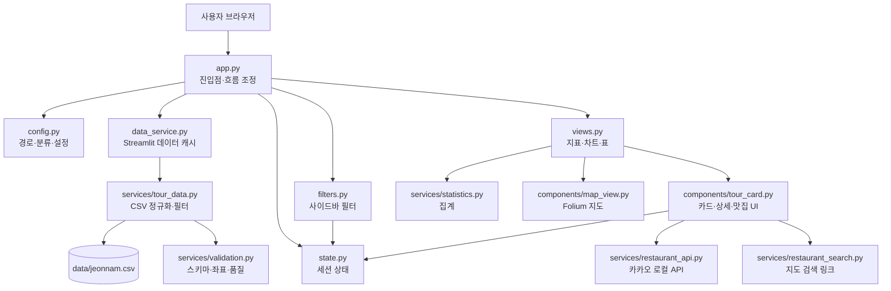
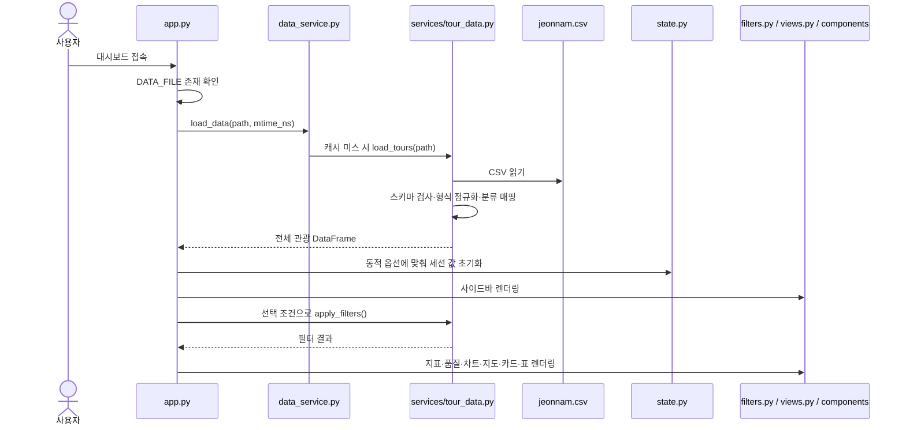

# RFC-001: 전남 관광 대시보드 아키텍처 및 상세 설계

| 항목 | 내용 |
|---|---|
| 상태 | Draft — 현행 코드 및 작업 트리 기준 |
| 작성일 | 2026-10-26 |
| 대상 | `D:\jeonnam_tour` |
| 문서 유형 | RFC 형식의 구조·상세 설계서 |
| 변경 범위 | 문서 작성. 애플리케이션 코드와 데이터는 변경하지 않음 |

## 목차

1. [요약](#1-요약)
2. [목적과 범위](#2-목적과-범위)
3. [시스템 구조](#3-시스템-구조)
4. [요청 및 데이터 흐름](#4-요청-및-데이터-흐름)
5. [모듈별 상세 설계](#5-모듈별-상세-설계)
6. [데이터 설계](#6-데이터-설계)
7. [세션·캐시 설계](#7-세션캐시-설계)
8. [주변 맛집 API 설계](#8-주변-맛집-api-설계)
9. [오류·보안·운영 설계](#9-오류보안운영-설계)
10. [테스트 설계](#10-테스트-설계)
11. [제약 및 후속 개선안](#11-제약-및-후속-개선안)
12. [설계 결정 기록](#12-설계-결정-기록)
13. [용어](#13-용어)

## 1. 요약

전남 관광 대시보드는 전남 관광지 CSV를 읽어 검색·필터·정렬하고, 결과를 지표·차트·지도·카드·표로 보여주는 Streamlit 앱입니다. 사용자는 관광지를 즐겨찾기하거나 상세 정보를 열 수 있습니다. 상세 보기에는 카카오 로컬 API를 이용한 주변 음식점 반경 검색이 추가되어 있으며, API 키가 없을 때는 네이버 지도와 카카오맵 검색 링크를 제공합니다.

구조는 진입점(`app.py`), Streamlit 캐시 경계(`data_service.py`), 프레임워크 비의존 데이터 처리(`services/tour_data.py`), UI 모듈, 검증·통계·외부 API 서비스로 나뉩니다. 별도 데이터베이스나 백엔드는 없으며 CSV가 기준 데이터입니다.

## 2. 목적과 범위

### 2.1 목적

- 전체 앱의 실행 순서와 모듈 책임을 설명합니다.
- 주요 데이터 필드의 생성·검증과 검색 동작을 기록합니다.
- 세션 상태, 캐시, 외부 API의 사용 조건을 명확히 합니다.
- 현재 제약과 후속 개선 항목을 코드 동작과 구분해 제안합니다.

### 2.2 범위

이 문서는 `D:\jeonnam_tour` 저장소의 앱 코드, 서비스, 컴포넌트, 테스트 및 `data/jeonnam.csv` 입력 구조를 다룹니다. 코드 흐름은 현재 작업 트리를 기준으로 설명합니다. 테스트 파일은 추가되어 있으나 이 문서 작성 과정에서 테스트를 다시 실행하지 않았습니다.

### 2.3 비목표

- 실제 카카오 API 키 발급 또는 설정
- CSV 원본 데이터 내용 수정
- 로그인, 사용자 계정, 영구 즐겨찾기 저장소 추가
- 앱 배포, GitHub 커밋 또는 푸시

## 3. 시스템 구조

### 3.1 디렉터리 구성

```text
jeonnam_tour/
├── app.py                         Streamlit 진입점 및 화면 실행 순서
├── config.py                      파일 경로, 분류, 기본값, API 설정, 스타일
├── data_service.py                Streamlit 캐시 어댑터 및 기존 서비스 진입점
├── state.py                       필터·즐겨찾기·선택 관광지 세션 상태
├── filters.py                     사이드바 위젯
├── views.py                       제목·지표·차트·지도·표·품질 UI
├── services/
│   ├── tour_data.py                CSV 로딩·정규화·필터 순수 로직
│   ├── validation.py               입력 스키마·지도 좌표·품질 검사
│   ├── statistics.py               차트 집계
│   ├── restaurant_api.py           카카오 음식점 API 클라이언트
│   └── restaurant_search.py        외부 지도 검색 링크 생성
├── components/
│   ├── map_view.py                 Folium 마커 클러스터 지도
│   └── tour_card.py                카드·상세·맛집 검색 결과 UI
├── data/
│   └── jeonnam.csv                 관광지 원본 입력
├── tests/                          데이터·필터·상태·서비스·AppTest
├── requirements.txt                런타임 의존성
└── requirements-dev.txt            테스트 의존성
```

### 3.2 컴포넌트 구조도



### 3.3 계층 책임

| 계층 | 모듈 | 책임 |
|---|---|---|
| 진입·조정 | `app.py` | Streamlit 설정, CSV 로딩, 세션 초기화, 필터 적용, 뷰 호출 |
| 설정 | `config.py` | 경로·코드표·기본 UI 값·검색 반경·API 키 취득 |
| 캐시 경계 | `data_service.py` | CSV 정규화 함수에 Streamlit `cache_data` 적용 및 기존 import 호환 |
| 데이터 서비스 | `services/tour_data.py` | pandas 기반 CSV 정규화, 필터·정렬, 지도 데이터 선택 |
| UI | `filters.py`, `views.py`, `components/` | 위젯과 화면 렌더링 |
| 도메인 지원 | `services/validation.py`, `statistics.py` | 데이터 검사와 차트 집계 |
| 외부 연동 | `services/restaurant_api.py`, `restaurant_search.py` | 카카오 음식점 조회, 외부 지도 링크 작성 |

## 4. 요청 및 데이터 흐름

### 4.1 초기 화면 렌더링



Streamlit은 위젯 값 변경 후 스크립트를 다시 실행합니다. `st.session_state`에서 필터 상태를 복원하고 현재 입력값으로 결과 DataFrame을 다시 계산합니다.

### 4.2 관광지 상세보기와 주변 맛집 검색

1. 카드의 상세보기 콜백이 `selected_tour`에 `record_id`를 저장합니다.
2. 다음 렌더에서 `app.py`는 현재 필터 결과를 `render_detail()`에 전달합니다.
3. 선택 ID가 필터 결과에 없으면 선택 상태를 비워 오래된 상세 정보가 남지 않게 합니다.
4. 선택 결과가 있으면 상세 주소·분류·사진·설명을 출력합니다.
5. 카카오 키가 있고 좌표가 유효하면 사용자가 반경을 선택하고 검색 버튼을 눌러 API를 호출합니다.
6. API 결과는 세션에 보관되고, 장소별 이름·거리·분류·주소·전화·지도 링크로 표시됩니다.
7. 키가 없더라도 네이버 지도·카카오맵의 주소 기반 검색 링크를 제공합니다.

## 5. 모듈별 상세 설계

### 5.1 `app.py` — 진입점

- `st.set_page_config()`로 페이지 제목·아이콘·레이아웃을 설정합니다.
- `config.DATA_FILE` 경로와 파일 수정 시각을 기준으로 CSV를 로드합니다.
- 파일 부재 또는 CSV·스키마 오류를 화면에 안내하고 앱 실행을 중단합니다.
- 데이터에서 지역·대분류·세부분류 선택지를 구성합니다.
- 세션 초기화 → 필터 UI → 필터 처리 → 지표·품질·시각화 순으로 호출합니다.
- 빈 검색 결과에서는 안내 문구를 표시하고, 상세 보기에는 현재 필터 결과만 전달합니다.
- Streamlit Secrets 객체를 읽지 못하는 환경은 예외 처리하고 API 키 조회를 환경 변수로 계속 시도합니다.

`app.py`는 비즈니스 로직을 직접 수행하기보다 호출 순서를 조정하는 역할입니다. 단, 필터 함수 인자를 개별 세션 키에서 직접 읽어 전달합니다.

### 5.2 `config.py` — 설정과 분류 명칭

- `DATA_FILE`: 코드 위치 기준 `data/jeonnam.csv`
- `DEFAULT_FILTERS`: 빈 멀티셀렉트, 기본 정렬, 카드 표시 수, 즐겨찾기 필터
- `CATEGORY_NAMES`, `SUBCATEGORY_NAMES`: 관광 코드와 화면 명칭 매핑
- `category_label()`, `subcategory_label()`: 알려지지 않은 코드를 `미분류 (코드)` 형태로 보존
- `RESTAURANT_RADIUS_DEFAULT`, `RESTAURANT_RADIUS_MAX`: 검색 UI 초기 반경 1,000m, API 상한 20,000m
- `get_restaurant_api_key()`: Streamlit Secrets를 우선 확인하고 환경 변수를 대체 경로로 조회
- `STYLE`: 앱 전체 CSS

미등록 코드도 그대로 구분해 표시하므로 새 코드가 유입될 때 `기타` 하나로 뭉개지지 않습니다.

### 5.3 `data_service.py`와 `services/tour_data.py`

`data_service.py`는 Streamlit에 종속된 얇은 캐시 어댑터입니다. `modified_ns`를 캐시 함수 인자로 받아 파일 수정 시각이 바뀌면 캐시 키도 달라집니다. 데이터 처리 로직은 순수 서비스 모듈로 위임합니다.

`load_tours()` 처리 순서:

1. UTF-8 BOM 형식을 우선 읽고, 디코딩 실패 시 CP949로 재시도합니다.
2. `validate_schema()`로 필수 입력 열을 확인합니다.
3. `Unnamed:` 인덱스 열을 제거하고 선택 열이 빠져 있으면 빈 값으로 추가합니다.
4. 제목·주소를 문자열로 정리하고 주소에서 시·군을 추출합니다.
5. `cat1`, `cat2`를 한글 라벨로 변환합니다.
6. `mapy`, `mapx`를 숫자형 위도·경도로 변환합니다.
7. `http://`, `https://`가 아닌 이미지 URL을 차단합니다.
8. `contentid`가 없으면 `row-<index>` 형식의 대체 ID를 만듭니다.

`apply_filters()`는 입력 DataFrame 복사본에 지역·대분류·세부분류·키워드·즐겨찾기 필터를 교집합으로 적용하고 지정한 정렬 규칙을 사용합니다. 키워드는 관광지명·주소·지역에서 대소문자 구분 없이 부분 일치하며 정규식이 아닌 리터럴 문자열로 처리합니다.

### 5.4 `state.py` — 세션 상태

| 키 | 초기값·역할 |
|---|---|
| `regions` | 선택 지역 목록 |
| `categories` | 선택 대분류 목록 |
| `subcategories` | 선택 세부분류 목록 |
| `keyword` | 통합 검색어 |
| `sort_option` | 정렬 기준 |
| `show_n` | 카드 표시 최대 개수 |
| `favorites_only` | 즐겨찾기 필터 사용 여부 |
| `favorites` | 현재 세션의 즐겨찾기 ID 목록 |
| `selected_tour` | 상세보기 대상 `record_id` |

초기화 시 현재 CSV에 없는 지역·분류 선택은 제거합니다. 필터 초기화는 필터 입력만 기본값으로 되돌리며 즐겨찾기·상세 선택 상태는 보존합니다.

### 5.5 UI 모듈

- `filters.py`: 지역·분류 멀티셀렉트, 키워드, 정렬, 카드 개수, 즐겨찾기 전용 표시, 필터 초기화 버튼
- `views.py`: 헤더·지표·지역/세부 분류 차트·지도·CSV 다운로드·데이터 품질표
- `components/tour_card.py`: 관광지 카드, 즐겨찾기/상세 버튼, 상세 정보, 맛집 검색 결과
- `components/map_view.py`: Folium 지도, 유효 좌표 필터, `MarkerCluster`, 안전한 팝업 문자열 처리

지도 중심은 유효 좌표의 위도·경도 중앙값입니다. 카테고리별 마커 색을 적용하며 데이터량이 많을 때 클러스터로 묶습니다.

### 5.6 검증·통계 서비스

- `services/validation.py`: 필수 열 검사, 좌표 범위 마스크, 품질 요약
- `services/statistics.py`: 지정 열별 건수를 집계해 차트 입력으로 반환
- `services/restaurant_search.py`: 관광지 주소·지역·이름을 검색 문구로 만들고 Naver/Kakao 지도 URL 인코딩

## 6. 데이터 설계

### 6.1 원본 입력 스키마

필수 열은 다음과 같습니다.

| 원본 열 | 의미 | 필수 |
|---|---|---|
| `title` | 관광지명 | 예 |
| `addr1` | 기본 주소 | 예 |
| `cat1` | 대분류 코드 | 예 |
| `mapx` | 경도 입력값 | 예 |
| `mapy` | 위도 입력값 | 예 |
| `cat2`, `cat3` | 세분류 코드 | 아니오 |
| `contentid` | 관광지 원본 ID | 아니오 |
| `firstimage` | 이미지 URL | 아니오 |
| `description` | 설명 본문 | 아니오 |
| `createdtime`, `modifiedtime` | 등록·수정 시각 | 아니오 |

### 6.2 정규화 데이터

| 생성 열 | 생성 규칙 / 사용처 |
|---|---|
| `region` | 주소에서 전남 시·군 추출, 실패하면 `지역 미상` |
| `category` | `cat1` 코드 매핑, 미등록 코드는 코드 포함 라벨 |
| `subcategory` | `cat2` 코드 매핑, 미등록 코드는 코드 포함 라벨 |
| `latitude` | `mapy` 숫자 변환 |
| `longitude` | `mapx` 숫자 변환 |
| `record_id` | `contentid`, 없으면 `row-<index>` |

### 6.3 좌표 규칙과 품질 한계

`map_valid_mask()`는 위도 33.0~36.0, 경도 125.0~128.2의 넓은 경계 상자 안 좌표를 지도에 표시합니다. 이는 행정경계 다각형 검사가 아니며, 좌표가 상자 안에 있다는 것만으로 전남 행정구역 안임을 확정하지 않습니다.

## 7. 세션·캐시 설계

### 7.1 저장 범위

- 필터·즐겨찾기·선택 관광지·맛집 검색 결과: Streamlit 사용자 세션 동안 유지
- CSV 정규화 결과: `st.cache_data`, 최대 4개 항목 및 파일 수정 시각 기반 무효화
- 음식점 API 결과: `st.cache_data`, 10분 TTL, 최대 128개 항목
- 영구 저장: DB나 사용자 계정 저장소 없음

### 7.2 재실행 동작

위젯 변경으로 스크립트가 재실행되며 세션 키의 입력을 다시 사용합니다. 맛집 검색 결과는 관광지 ID와 반경을 포함하는 세션 키에 저장해 UI 재실행 후에도 다시 표시합니다. 검색 결과는 별도로 캐시되어 동일 좌표·반경 요청에 대한 반복 API 호출을 줄입니다.

## 8. 주변 맛집 API 설계

### 8.1 요청 계약

| 항목 | 값 |
|---|---|
| 제공자 | Kakao Local API |
| 엔드포인트 | `/v2/local/search/category.json` |
| 카테고리 | `FD6` 음식점 |
| 기준 좌표 | 관광지 위도·경도 (`y=latitude`, `x=longitude`) |
| 반경 | UI에서 500~20,000m, 기본 1,000m, 500m 단위 |
| 정렬 | `distance` 오름차순 |
| 페이지 결과 수 | 요청당 최대 15개 |
| 요청 제한 시간 | 8초 |
| 인증 헤더 | `Authorization: KakaoAK <REST_API_KEY>` |
| 호출 조건 | 사용자가 상세 보기에서 검색 버튼을 누른 경우 |

### 8.2 결과 모델

API 응답에서 아래 필드만 선택해 UI에 전달합니다.

```text
name        장소 이름
category    Kakao 카테고리 문자열
address     도로명 주소 우선, 없으면 지번 주소
distance_m  기준 관광지로부터 거리(m)
phone       전화번호
url         Kakao 지도 장소 상세 링크
```

검색 오류는 `RestaurantSearchError`로 변환해 키 원문이나 공급자 응답 본문을 사용자 메시지에 포함하지 않습니다. API 키가 설정되지 않거나 좌표가 없으면 실시간 검색은 제공하지 않고, 기존 외부 지도 검색 링크를 남깁니다.

### 8.3 키 설정

- 환경 변수: `KAKAO_REST_API_KEY`
- Streamlit 배포: 앱 Secrets에 같은 이름으로 등록
- 키는 코드·CSV·Git 저장소에 넣지 않습니다.

## 9. 오류·보안·운영 설계

### 9.1 오류 처리

| 오류 | 처리 |
|---|---|
| CSV 파일 부재 | `app.py`가 파일 경로를 안내하고 앱 중단 |
| 필수 열 누락·인코딩·I/O 오류 | 사용자에게 데이터 로딩 실패를 표시하고 앱 중단 |
| 검색 결과 없음 | 필터 초기화 안내 표시 |
| 상세 선택이 현재 필터에 없음 | `selected_tour`를 비워 stale detail 제거 |
| 음식점 API 인증 오류 | HTTP 상태를 포함한 설정 안내 |
| 음식점 네트워크·JSON 오류 | 재시도 안내를 표시하고 키를 숨김 |
| 관광지 좌표 없음 | 실시간 반경 검색 안내, 외부 지도 링크 유지 |

### 9.2 보안 고려

- Folium 팝업의 관광지명·지역·주소는 HTML escape 후 삽입합니다.
- 이미지 표시 대상은 HTTP(S) 스킴으로 제한합니다.
- API 키는 Secrets/환경 변수에서 읽어 UI 문자열로 직접 렌더링하지 않습니다.
- 캐시 인자에 API 키가 포함되므로 Streamlit 캐시는 서버 내부 실행 캐시로만 취급해야 합니다. 키를 캐시 로그나 오류 메시지에 출력하지 않습니다.
- CSV 자체는 신뢰된 배포 데이터로 전제합니다. 업로드 CSV 기능은 현재 없습니다.

### 9.3 실행 및 의존성

- 실행: `python -m streamlit run app.py`
- 런타임: Streamlit, pandas, Plotly, Folium, streamlit-folium, requests
- 개발: pytest, pytest-cov
- 데이터 위치: 코드 파일 기준 `data/jeonnam.csv`

## 10. 테스트 설계

| 파일 | 검증 범위 |
|---|---|
| `tests/test_filters.py`, `test_filters_extended.py` | 필터 교집합, 키워드, 정렬, 즐겨찾기, 집계 |
| `tests/test_data_loading.py` | CSV 정규화, 선택 열, 좌표, 인코딩, 입력 오류 |
| `tests/test_tour_data.py` | UI 프레임워크 비의존 데이터 처리, 새 분류 코드 |
| `tests/test_restaurant_search.py` | 지도 URL 검색어 생성·인코딩 |
| `tests/test_restaurant_api.py` | API 요청 파라미터·결과 정규화·HTTP 오류 (mock) |
| `tests/test_state.py` | 세션 초기화·필터 리셋·즐겨찾기·상세 선택 |
| `tests/test_validation.py`, `test_validation_extended.py` | 스키마·좌표·품질 검사 |
| `tests/test_ui_detail.py` | Streamlit AppTest 상세 표시·필터 제외 후 선택 해제 |

API 테스트는 실 네트워크와 실제 키를 사용하지 않도록 HTTP 클라이언트를 mock 처리합니다. AppTest는 상세 컴포넌트의 선택 상태와 렌더링을 확인합니다. 이 문서 작성 과정에서는 테스트를 실행하지 않았으므로 현재 통과 여부를 주장하지 않습니다.

## 11. 제약 및 후속 개선안

| 우선순위 | 개선 제안 | 현재 영향 |
|---|---|---|
| P1 | `app.py`의 긴 인자 전달을 필터 조건 객체나 서비스 함수로 정리 | 신규 필터 추가 시 진입점 수정 범위가 커질 수 있음 |
| P1 | `state.py`에 선택 관광지 무효화 정책을 중앙화 | 선택 상태 초기화 규칙이 화면 렌더링에 일부 의존 |
| P1 | 카카오 API 페이지네이션 또는 결과 개수 선택 추가 | 현재 한 요청의 최대 15개 결과만 보여줌 |
| P1 | `requests` 오류·응답 스키마와 API 응답 변화 회귀 테스트 확장 | 제공자 응답 필드 변경 시 UI 결과가 달라질 수 있음 |
| P2 | 지도에서 관광지와 음식점을 함께 비교 표시 | 현재 API 결과는 상세 패널 목록으로만 렌더링 |
| P2 | 위치 범위에 행정구역 polygon 검증 적용 | 현재 지도 좌표 검사는 넓은 사각 경계 기반 |
| P2 | UI 렌더링 테스트를 카드·빈 결과·맛집 API 성공/실패 상태로 확대 | 현재 AppTest 범위는 상세 표시와 선택 해제 중심 |
| P3 | 데이터 갱신일·출처·저작권 메타데이터 표시 | CSV 원본의 시점과 사용 조건을 화면에서 바로 알기 어려움 |

실제 음식점 검색은 API 키와 제공자 사용 설정이 필요합니다. 키가 없는 개발 환경에서도 기본 대시보드와 외부 지도 검색 링크는 동작하도록 설계되어 있습니다.

## 12. 설계 결정 기록

### D-001 — 데이터 변환 로직을 Streamlit에서 분리

- **상태:** 적용
- **결정:** CSV 정규화·필터 로직은 `services/tour_data.py`에 두고, `data_service.py`는 Streamlit 캐시 경계로 사용합니다.
- **이유:** pandas 로직을 UI 런타임 없이 단위 테스트할 수 있도록 합니다.

### D-002 — 분류 코드 미등록 시 원본 코드를 유지

- **상태:** 적용
- **결정:** `미분류 (코드)` 라벨로 렌더링합니다.
- **이유:** 새 분류값을 숨기지 않고 운영자가 파악할 수 있게 합니다.

### D-003 — 맛집 결과 제공과 지도 검색 링크를 병행

- **상태:** 적용
- **결정:** 키가 있으면 카카오 음식점 반경 검색을 제공하고, 항상 외부 지도 검색 링크를 노출합니다.
- **이유:** API 키 미설정 시에도 위치 기반 검색 경로를 제공합니다.

### D-004 — 상세 정보는 현재 필터 결과와 일치

- **상태:** 적용
- **결정:** `render_detail()`에 전체 DataFrame 대신 필터 결과를 전달하고, 선택 ID가 없으면 상태를 초기화합니다.
- **이유:** 필터에서 숨겨진 관광지의 오래된 상세 내용이 남지 않게 합니다.

## 13. 용어

| 용어 | 설명 |
|---|---|
| `record_id` | 앱 내부에서 카드·즐겨찾기·상세 선택을 연결하는 식별자 |
| 캐시 어댑터 | 순수 서비스 함수 주변에 Streamlit 캐싱 기능을 적용하는 얇은 계층 |
| 세션 상태 | 사용자 브라우저 세션 동안 Streamlit 재실행 사이 값을 보존하는 저장소 |
| 반경 검색 | 관광지 좌표에서 지정한 거리 안의 음식점 검색 |
| AppTest | Streamlit 앱의 컴포넌트·위젯 상태를 파이썬에서 검증하는 도구 |
